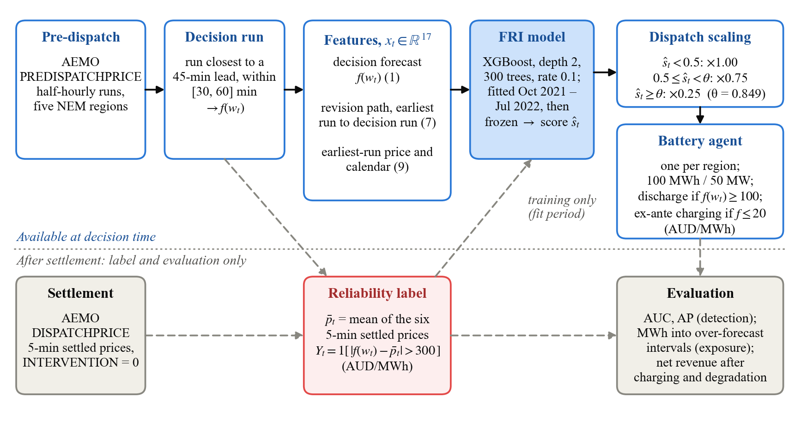
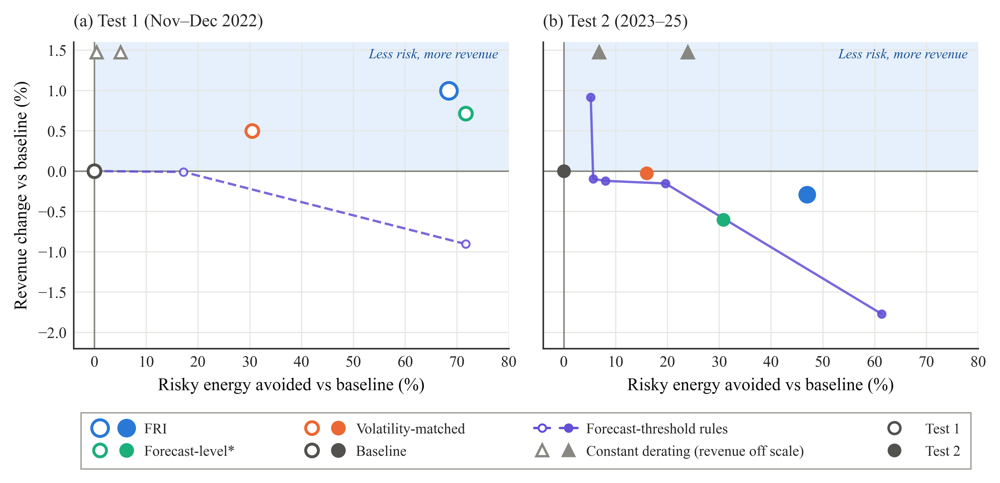
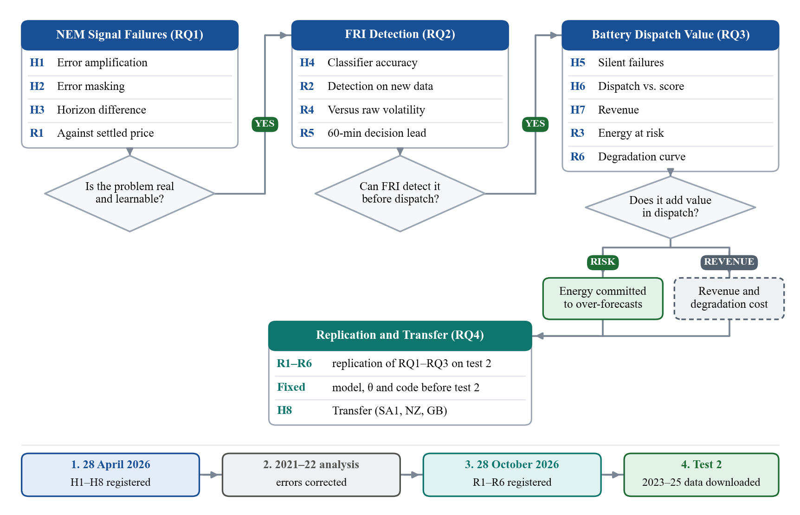
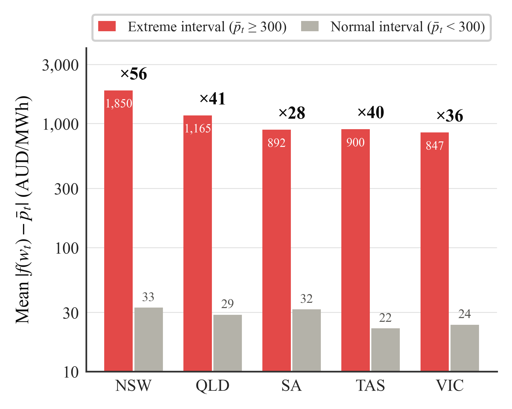
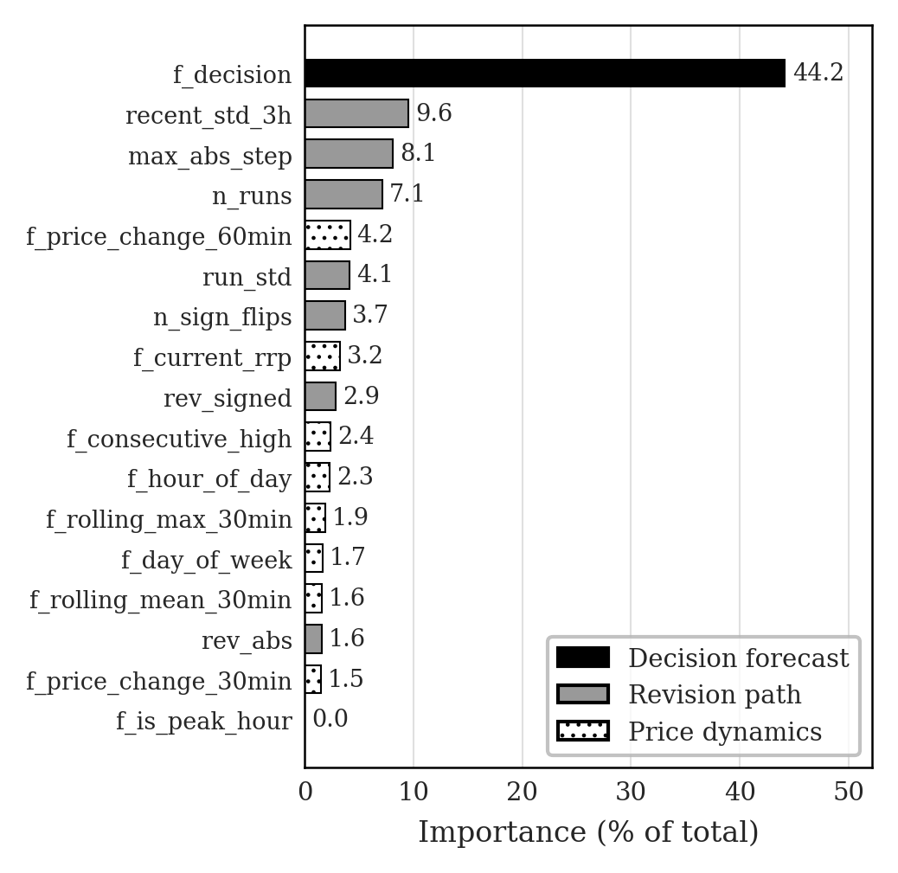

# Forecast Reliability Indicator (FRI)

[](LICENSE)
[](https://python.org)
[](https://doi.org/10.17605/OSF.IO/Z89HD)

**Forecast Reliability Indicator for Risk-Aware Energy-Arbitrage Battery Dispatch in the Australian National Electricity Market**

---

## Abstract

Battery operators in the Australian National Electricity Market commit energy on pre-dispatch price forecasts, yet these forecasts are least accurate in the extreme-price intervals where commitment matters most. This paper develops a Forecast Reliability Indicator (FRI) that estimates, at the moment of commitment, whether the forecast an agent is about to act on will miss the settled price by more than AUD 300/MWh, using only the forecast level and the revision path of the pre-dispatch runs published by then. In a pre-registered out-of-sample replication on 2023–2025 data, with the model fixed in advance, the error of the decision forecast was 28 to 56 times larger in extreme than in normal intervals, and 22 to 84 times larger when extreme intervals were identified by the forecast itself, where it was less accurate than a naive three-hour average. The FRI ranked unreliable intervals with an AUC of 0.955, against 0.906 for the forecast level alone, although both reached the same average precision (0.64). Scaling discharge by the FRI cut the energy committed to over-forecast intervals by 47%, more than volatility-matched scaling, and no forecast-threshold rule dominated it on both exposure and revenue. Net revenue changed by −0.3% in 2023–2025 and +1.0% in the held-out 2022 window, while discharges into extreme intervals with an overstated forecast rose from 8 to 16. The registered F1 and revenue criteria were not met, and constant derating earned more under convex degradation. The FRI is therefore a risk-exposure control for energy-arbitrage dispatch, not a revenue optimiser.

**Keywords:** forecast reliability; pre-dispatch price forecasts; battery energy storage; National Electricity Market; energy arbitrage; risk-aware dispatch; pre-registered replication

---

## FRI pipeline



*Fig. 2. FRI pipeline, applied to each of the five NEM regions; each region has its own battery agent. Solid arrows carry information available at decision time; dashed arrows mark steps that use settled prices and take place only after settlement: building the label for model fitting and evaluating the agent. θ = 0.849089 was chosen on the validation period.*

---

## Contents

1. [Abstract](#abstract)
2. [FRI pipeline](#fri-pipeline)
3. [Summary of findings](#summary-of-findings)
4. [Study design and registration](#study-design-and-registration)
5. [Method](#method)
6. [Results](#results)
7. [Repository structure](#repository-structure)
8. [Versions and tags](#versions-and-tags)
9. [Reproducing the results](#reproducing-the-results)
10. [Data sources](#data-sources)
11. [Correction history](#correction-history)
12. [Citation](#citation)
13. [Licence](#licence)

---

## Summary of findings

- Pre-dispatch forecast error against the settled price was **28 to 56 times larger** in extreme intervals than in normal ones (2023–2025), and **22 to 84 times larger** when extreme intervals were identified by the forecast itself, before the outcome was known.
- The FRI detected unreliable decision forecasts with an **AUC of 0.955** and an average precision of **0.643**, against 0.279 for raw recent volatility.
- Scaling battery dispatch by the score cut the energy committed to intervals over-forecast by more than AUD 300/MWh by **47.0%** (954.0 vs 1,800.0 MWh), more than a volatility-matched control (−16.0%), at a net-revenue cost of **0.29%**.
- Not every registered test was supported: the score missed its F1 criterion on the short 2022 window (H4), did not raise revenue (H7), and blanket derating earned more when degradation was convex.

The FRI is best used as a **risk signal alongside a dispatch or bidding policy**, not as a strategy on its own.



*Fig. 8. Exposure reduction and net-revenue change of the dispatch agents relative to the baseline on (a) test 1 and (b) test 2 (β = 2.03). Shaded: better than the baseline on both.*

---

## Study design and registration



*Fig. 4. Study design: research questions, hypotheses and order of registration.*

| Stage | Date | What was fixed or tested |
|---|---|---|
| Original registration (H1–H8) | 28 April 2026 | Hypotheses and criteria, registered on OSF (doi:[10.17605/OSF.IO/Z89HD](https://doi.org/10.17605/OSF.IO/Z89HD)) |
| Original analysis | 2026 | H1–H3 on 2021–22 error data; H4–H7 on test 1 (Nov–Dec 2022); H8 on transfer data |
| Pipeline correction | Oct 2026 | Errors in the initial pipeline corrected on 2021–22 data (see [Correction history](#correction-history)) |
| Replication registration (R1–R6) | 28 October 2026 | OSF amendment; model, label threshold, battery settings and code fixed and tagged **13 minutes before** the first 2023–2025 file was downloaded |
| Replication | Oct 2026 | R1–R6 tested out of sample on 2023–2025 (test 2) |

Analyses added during peer review are labelled **exploratory** and are not part of the registered tests.

---

## Method

**Label.** An interval is *unreliable* when the decision forecast misses the settled price by more than AUD 300/MWh in either direction:

```
|f(w_t) − p̄_t| > 300 AUD/MWh
```

The label is two-sided because it scores the reliability of the forecast itself. A one-sided variant (over-forecasts only) is examined as an exploratory analysis.

**Model.** XGBoost classifier on 17 features available before each interval, grouped into the decision forecast, the revision path across successive pre-dispatch runs, and other context. In TreeSHAP attributions on test 1, the decision forecast accounts for 44.2% of mean absolute attribution, the revision path for 37.1% and other features for 18.7%.

**Threshold.** θ = 0.849089, chosen at maximum F1 on the validation precision–recall curve.

**Data partitions (five NEM regions).**

| Partition | Period | Intervals | Unreliable |
|---|---|---|---|
| Fitting | 2021–2022 | 72,865 | 2,371 (3.25%) |
| Validation | 2022 | 14,640 | 60 (0.41%) |
| Test 1 | Nov–Dec 2022 | 14,650 | 94 (0.64%) |
| Test 2 (replication) | 2023–2025 | 261,635 | 1,684 (0.64%) |

**Dispatch agents.** A battery (β = 2.03) dispatched by:

| Agent | Rule |
|---|---|
| Baseline | Unscaled dispatch |
| FRI three-band | Dispatch scaled ×1, ×0.75 or ×0.25 by the FRI score |
| Volatility-matched | Same band counts as FRI, assigned by recent volatility |
| Forecast-level-matched* | Same band counts as FRI, assigned by the highest decision forecast |
| Constant derating | All intervals scaled ×0.75 or ×0.25 |
| Forecast-threshold rules* | ×0.25 whenever the decision forecast reaches X, X = AUD 300–5,000/MWh |

\* Exploratory controls, not registered.

**Inference.** 95% confidence intervals from 1,000 bootstrap resamples drawn separately from unreliable and reliable intervals; exploratory day-block bootstrap (whole days resampled) because unreliable intervals cluster in time.

---

## Results

### Replication hypotheses (2023–2025, test 2)

| Hypothesis | Criterion | Result | Outcome |
|---|---|---|---|
| R1 | Extreme-interval error exceeds normal-interval error | Ratio 28–56× by region | Supported |
| R2 | AUC ≥ 0.75 | AUC 0.955 | Supported |
| R3 | FRI reduces over-forecast exposure vs volatility-matched control | Difference 557.6 MWh [387.7, 744.6] | Supported |
| R4 | FRI AP exceeds raw volatility | ΔAP 0.363 [0.344, 0.382] (0.643 vs 0.279) | Supported |
| R5 | AUC ≥ 0.75 at a 60-min lead | AUC 0.959 [0.954, 0.965] | Supported |
| R6 | Ranking under alternative degradation shapes | Reported descriptively | Descriptive |



*Fig. 5. Mean absolute error of the decision forecast against the settled price in extreme and normal intervals, test 2 (2023–25; log scale). Bold labels give the ratio of means.*



*Fig. 6. ROC (a) and precision–recall (b) curves of the FRI model on test 2 (2023–25; solid) and test 1 (2022; dashed). Orange: raw recent volatility (recent_std_3h), the R4 comparison. Aqua: the decision forecast alone (exploratory). Dotted lines: chance (a) and no-skill precision, equal to the 0.64% prevalence (b).*

### Original hypotheses

| Hypothesis | Data | Result | Outcome |
|---|---|---|---|
| H1 | 2021–22 | Extreme/normal MAE ratio 4.39 (SA1) to 23.50 (VIC1), p < 0.001 in every region | Supported |
| H2 | 2021–22 | NEM-wide MAE understated extreme-interval MAE by 77.28% | Supported |
| H3 | 2021–22 | Final vs earlier run error, t = 0.106, p = 0.915 | Not supported |
| H4 | Test 1 | F1 0.476 < 0.60 (AUC 0.900) | Not supported |
| H5 | Test 1 | Unwarned unreliable intervals 94 → 54 (−42.6%) | Supported |
| H6 | Test 1 | r = 0.318 [0.243, 0.389] (manipulation check) | Supported |
| H7 | Test 1 | Revenue criterion not met | Not supported |
| H8 | Transfer | Met for SA1 (F1 0.858, AUC 0.967); not met for New Zealand (0.079, 0.840) or Great Britain (0.078, 0.980) | Partially supported |

H8 was evaluated with the initial label only; the final pipeline was not re-run on the transfer data.

### Battery exposure (over-forecast energy, MWh)

| Agent | Test 1 (2022) | Test 2 (2023–25) |
|---|---|---|
| Baseline | 65.0 | 1,800.0 |
| FRI three-band | 20.5 (−68.5%) | 954.0 (−47.0%) |
| Volatility-matched | 45.2 (−30.5%) | 1,511.6 (−16.0%) |
| Forecast-level-matched* | 18.4 (−71.7%) | 1,245.2 (−30.8%) |
| Constant ×0.75 | 61.7 (−5.1%) | 1,677.0 (−6.8%) |
| Constant ×0.25 | 64.7 (−0.5%) | 1,368.8 (−24.0%) |

Test 1 contains only three baseline over-forecast intervals, so its percentages are indicative.

---

## Repository structure

```
forecast-reliability-indicator/
│
├── README.md                 this file
├── LICENSE                   Apache License 2.0
├── requirements.txt          Python dependencies
├── run.sh                    runs a script with the project root on PYTHONPATH
│
├── config/
│   ├── settings.py           paths, regions, label threshold, battery settings (single source of all constants)
│   └── logging_config.py     logging set-up
│
├── data/
│   └── samples/              one-week samples of each market (nem_sample.csv, nz_sample.csv, gb_sample.csv);
│                             full data are downloaded by the c1_/c3_/c4_ download scripts
│
├── scripts/                  analysis pipeline, numbered in run order
│   ├── c1_*.py   (27)        Component 1: NEM download, validation, preprocessing, labels, H1–H3
│   ├── c2_*.py   (25)        Component 2: features, model fitting, evaluation, SHAP, H4
│   ├── c3_*.py   (51)        Component 3: battery agents, H5–H7, NZ/GB download and H8 transfer
│   ├── c4_*.py   (10)        Replication: 2023–2025 download, rebuild, R1–R6, block bootstrap
│   ├── block_inference.py, detection_baselines.py, r1_forecast_conditioned.py,
│   │   one_sided_dispatch.py, frontier_threshold_rule.py, theta_sensitivity.py,
│   │   leakage_timestamp_audit.py         exploratory analyses added in revision
│   ├── build_numbers.py      collects every number reported in the manuscript
│   ├── make_tables.py        manuscript tables
│   ├── make_figures.py       manuscript figures (Figs. 1, 3, 5–7, 9, A.1)
│   ├── make_fig2.py          Fig. 2 (FRI pipeline)
│   ├── make_fig4_design.py   Fig. 4 (study design)
│   ├── fig_frontier.py       Fig. 8 (risk–revenue trade-off)
│   ├── fri_style.py          shared figure style
│   └── figure_*.py           figures of the first version (superseded)
│
├── results/
│   ├── figures/              manuscript figures (PNG, PDF, SVG) and captions.md
│   │   ├── fig_1 … fig_9, fig_A1
│   │   ├── fig_2             FRI pipeline
│   │   ├── fig_4_design      study design (manuscript Fig. 4)
│   │   ├── fig_8_frontier    risk–revenue trade-off (manuscript Fig. 8)
│   │   └── v1_1_archive/     figures of the first version (superseded)
│   ├── tables/               result tables (CSV), prefixed by component (c1_ … c4_)
│   └── models/               frozen XGBoost models (.pkl)
│
├── audit/
│   └── gate_A_decision.md    dated decision record of 28 October 2026 (interim numbers)
│
└── docs/
    ├── DATA_CARD.md          provenance, access, coverage and licence of every dataset
    ├── COMPLIANCE.md         chronological decision and compliance log
    ├── FRI_MASTER_REFERENCES.md   reference list of the manuscript
    └── archived/             superseded material from the first version
        ├── README_v1.1.md    README of the first version
        └── RESULTS_v1.1.md   results summary of the first version
```

Scripts are prefixed by component (`c1_` problem and data, `c2_` model, `c3_` dispatch and transfer, `c4_` replication).

---

## Versions and tags

| Tag | Commit | Contents |
|---|---|---|
| `R-prereg-2026-10-28-clean` | `3b1723c` | Code fixed at the replication registration, before 2023–2025 data were downloaded |
| `R-results-2026-10-28` | `23a6096` | Replication results |
| `R-revision-2026-11` | `c0f4543` | Intermediate revision state |
| `R-revision-final-2026-11` | `13c51a4` | Code, figures and results of the revised manuscript |

To check out the registered code exactly as it was fixed:

```bash
git checkout R-prereg-2026-10-28-clean
```

---

## Reproducing the results

Requires Python 3.10 or later.

```bash
git clone https://github.com/Gleeblick22/forecast-reliability-indicator.git
cd forecast-reliability-indicator
pip install -r requirements.txt

# manuscript figures
PYTHONPATH=.:scripts python3 scripts/make_figures.py
PYTHONPATH=.:scripts python3 scripts/fig_frontier.py
PYTHONPATH=.:scripts python3 scripts/make_fig2.py
PYTHONPATH=.:scripts python3 scripts/make_fig4_design.py
```

Figures are written to `results/figures/`.

---

## Data sources

All data are public. Raw market data are not redistributed in this repository; the scripts download them from the sources below. Full download paths are in [docs/DATA_CARD.md](docs/DATA_CARD.md).

### Australia — National Electricity Market (NEM)

| Item | Detail |
|---|---|
| Provider | Australian Energy Market Operator (AEMO) |
| Archive | NEMweb, https://nemweb.com.au: pre-dispatch archive (PREDISP_ALL_DATA) and MMSDM historical archive |
| Pre-dispatch forecasts | `PREDISPATCHPRICE`: 30-min regional price forecasts from every pre-dispatch run, used for the decision forecast f(w_t) and the revision-path features |
| Settled prices | `DISPATCHPRICE`: 5-min regional dispatch prices, averaged to the 30-min settled price p̄_t |
| Regions | NSW1, QLD1, SA1, TAS1, VIC1 |
| Periods | 2021–2022 (fitting, validation, test 1); 2023–2025 (replication, test 2) |
| Access | Public, no authentication |

### New Zealand — wholesale electricity market (H8 transfer)

| Item | Detail |
|---|---|
| Provider | Electricity Authority (Te Mana Hiko) |
| Dataset | Predispatch Revised Schedule and Sensitivity (PRSS), North and South Island, 30-min runs |
| Archive | EMI, https://www.emi.ea.govt.nz/Wholesale/Datasets/DispatchAndPricing/CaseFiles/PRSS/ |
| Storage | Azure Blob Storage mirror, https://emidatasets.blob.core.windows.net/publicdata (public read-only access token published by the Electricity Authority) |
| Period | February 2021 – October 2022 |
| Licence | Creative Commons Attribution 4.0 International |
| Use | Cross-market transfer test (H8), initial label only |

### Great Britain (H8 transfer)

| Item | Detail |
|---|---|
| Provider | Elexon Limited |
| Dataset | Settlement System Prices, BMRS Insights Solution API, https://data.elexon.co.uk/bmrs/api/v1/balancing/settlement/system-prices |
| Period | January 2021 – December 2022 |
| Licence | BMRS open-data licence: personal, academic or non-commercial use with attribution ("Contains BMRS data © Elexon Limited") |
| Limitation | No published sequence of pre-dispatch runs, so the revision-path features and the decision forecast cannot be formed; the transfer model uses the remaining nine features |
| Use | Cross-market transfer test (H8), initial label only, with the original and a harmonised threshold |

### Australia — licence

AEMO data are used under the AEMO Copyright Permissions Notice (general permission for any purpose, with attribution).

Full provenance, coverage and processing details are in [docs/DATA_CARD.md](docs/DATA_CARD.md).

---

## Correction history

The first version of this analysis used a pipeline that was later found to contain errors. Under that pipeline the model reached a test AUC of 0.967 and an F1 of 0.890, against 0.900 and 0.476 after correction. The errors were corrected on the 2021–22 data before the replication was registered, and all results in this README and in the manuscript use the corrected pipeline. The README of the first version is kept in `docs/archived/README_v1.1.md` for transparency only; its results are superseded.

---

## Citation

The manuscript is under review. Full citation details (journal, volume, pages and DOI) will be added here after acceptance.

Pre-registration: doi:[10.17605/OSF.IO/Z89HD](https://doi.org/10.17605/OSF.IO/Z89HD)

---

## Licence

Apache License 2.0. See [LICENSE](LICENSE).
